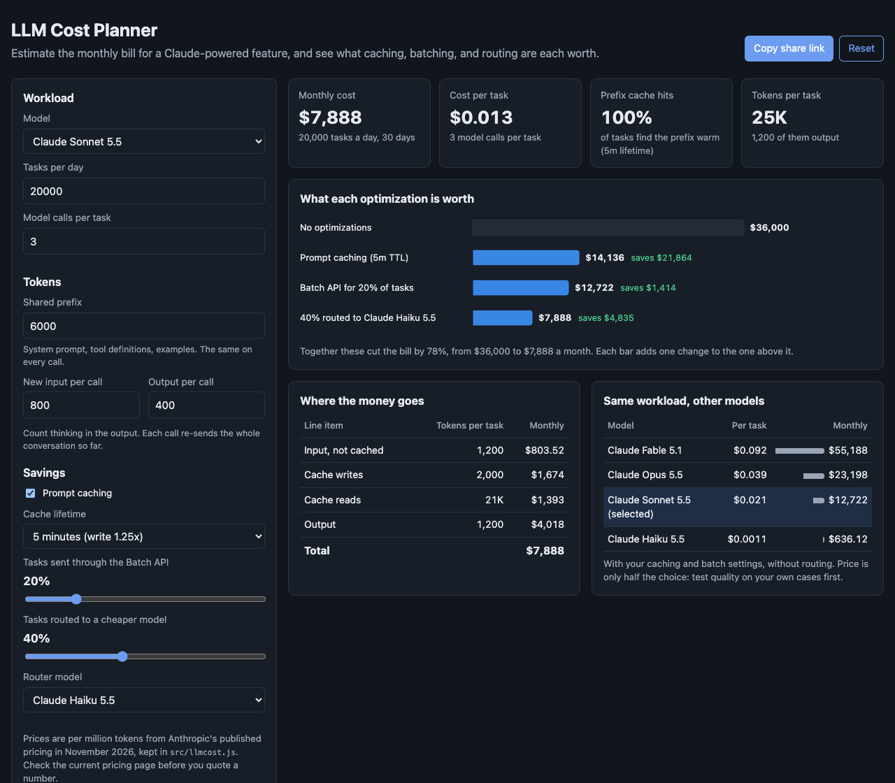

# LLM Cost Planner

A browser tool that estimates the monthly bill for a feature built on Claude, from its traffic and the shape of its prompts. It shows what prompt caching, the Batch API, and routing easy tasks to a cheaper model are each worth, and prices the same workload on every current model.



## Why

LLM cost estimates usually start as "tokens times price" and end up off by several times, in both directions. The real bill depends on things that simple math leaves out:

- **Conversations grow.** An agent that makes three model calls per task re-sends the whole conversation each time, so input tokens grow much faster than the number of calls.
- **Caching changes the input price.** A shared system prompt read from cache costs a small fraction of normal input. Writing it costs more than normal input. Whether caching saves money depends on how often requests arrive.
- **Not every task needs the same model or the same speed.** Background work can go through the Batch API at half price, and simple tasks can go to a much cheaper model.

This tool models each of those so a product or engineering team can see where the money goes before they build.

## How it calculates

- **Per call.** Call *t* of a task sends the shared prefix, every earlier call's input and output, and its own new input. Output is billed at the output price and includes thinking tokens.
- **Prefix caching.** Tasks arrive at random, so the chance the prefix is still cached is `1 - exp(-rate x TTL)`. A warm prefix is billed as a cache read, a cold one as a cache write at 1.25x (5-minute lifetime) or 2x (1 hour). Prefixes under 512 tokens are not cached.
- **Conversation caching.** Within a task, each call reads what earlier calls cached and writes only what is new. The last call's new tokens are never read again, so they are not written.
- **Batch.** The chosen share of tasks is billed at 50%.
- **Routing.** The chosen share of tasks goes to the router model. That traffic has its own, smaller stream, so its prefix cache is colder.
- **Long context.** Haiku 5.5 charges a higher rate on any call over 100K prompt tokens.

The savings chart adds one optimization at a time, so each bar shows what that change is worth on its own. When caching would cost more than it saves at low volume, the tool says so and gives the break-even rate.

## Pricing

All prices are in one object, `MODELS` in `src/llmcost.js`, in US dollars per million tokens. They come from Anthropic's published pricing as of November 2026: Fable 5.1, Opus 5.5, Sonnet 5.5, and Haiku 5.5, with each model's own cache read price. Haiku 5.5's cache read price is not listed separately and is assumed at the usual 0.1x of input. Check the current pricing page before you quote a number.

## Run it

It is a static site with no build step and no dependencies.

- **GitHub Pages:** enable Pages for the repo and serve from the root of the default branch.
- **Locally:** ES modules need a web server, so `file://` will not work. From this folder run:

```bash
python3 -m http.server 8000
```

Then open http://localhost:8000.

## Tests

The cost model lives in `src/llmcost.js` with no DOM code, so it runs under Node's built-in test runner.

```bash
npm test
```

17 tests check the token math against hand calculations, that cached and uncached tokens always add up to the full prompt, the cache write multipliers, the hit rate formula, Haiku's long-context rate, batch and routing, that caching can lose money at very low volume, the break-even rate, and URL round-trips.

## License

MIT. See [LICENSE](LICENSE).
